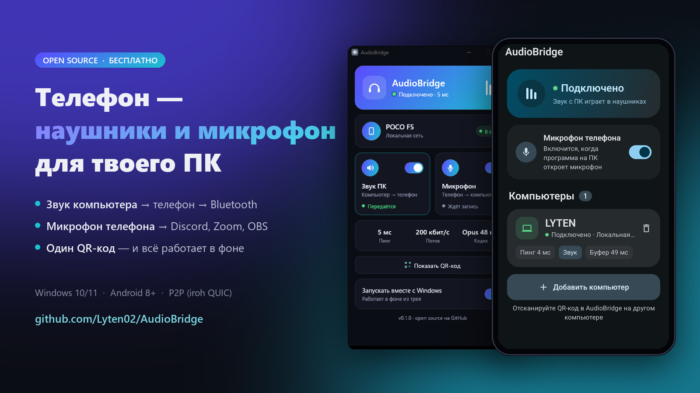
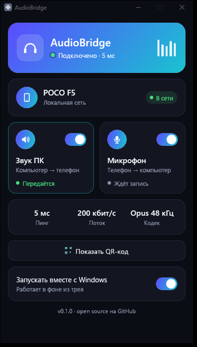
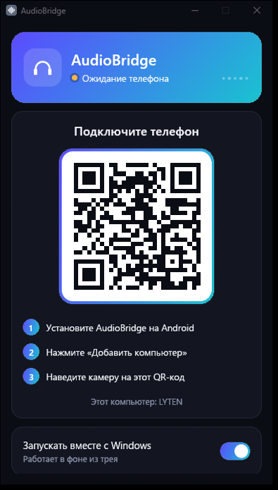
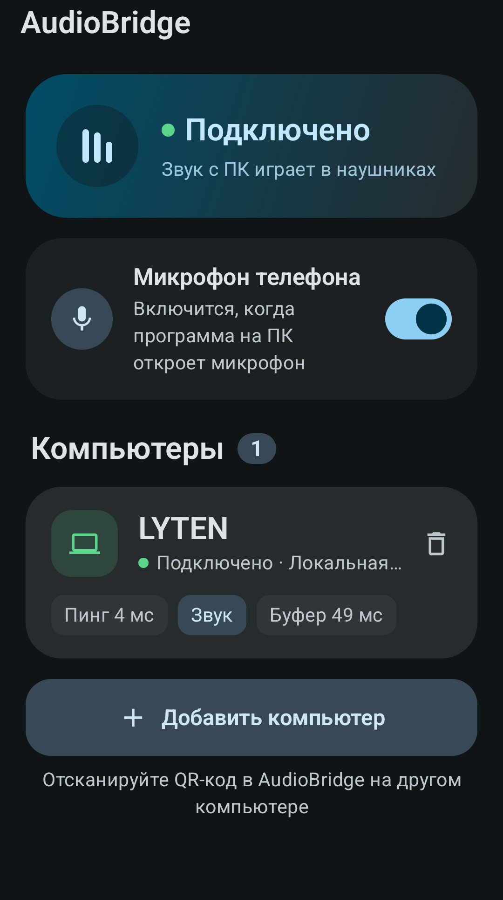
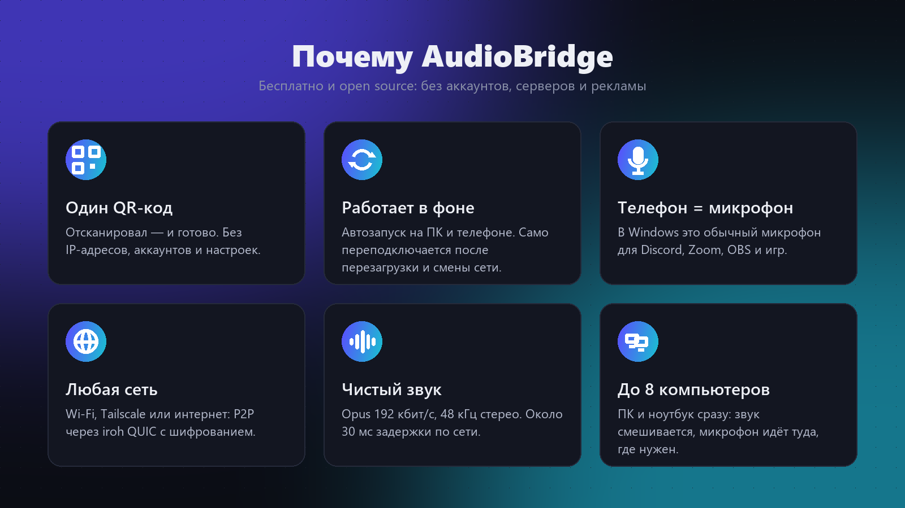

# AudioBridge



**Телефон становится беспроводными наушниками и микрофоном для компьютера с Windows или Linux.**

AudioBridge передаёт весь звук компьютера на Android-телефон, а тот играет его в Bluetooth-наушники, подключённые к телефону. В обратную сторону микрофон телефона появляется на ПК как обычный микрофон для Discord, Zoom, OBS и игр.

Один раз сканируешь QR-код. Дальше оба приложения работают в фоне, запускаются вместе с системой и сами переподключаются. Без аккаунтов, без серверов и без ввода IP-адресов.

[English version](README.md)

<p align="center">
  
  &nbsp;
  
  &nbsp;
  
</p>



## Возможности

- **Звук ПК → телефон → Bluetooth-наушники.** Opus 192 кбит/с, стерео, 48 кГц. Задержка сети по Wi-Fi около 30–40 мс; сам Bluetooth добавляет свои обычные 100–200 мс.
- **Микрофон телефона → ПК.** В Windows виден как `CABLE Output` (VB-CABLE); в Linux AudioBridge сам создаёт микрофон PipeWire «AudioBridge: микрофон телефона» (драйвер не нужен, микрофон исчезает при выходе из программы). Телефон отправляет микрофон, только когда какая-то программа на ПК действительно записывает.
- **Сопряжение одним сканом QR-кода.**
- **Работает между разными сетями.** P2P через [iroh](https://iroh.computer) QUIC: локальная сеть, пробой NAT, Tailscale, а в крайнем случае зашифрованный relay. Телефону и ПК не обязательно быть в одном Wi-Fi.
- **Несколько компьютеров сразу.** До 8 ПК (стационарный, ноутбук, …): их звук смешивается, а микрофон уходит только туда, где он нужен. Звук отдельного ПК или всех сразу можно выключить одной кнопкой прямо с телефона, связь при этом не рвётся.
- **Полный пульт с обеих сторон.** С ПК: громкость компьютера и телефона, микрофон телефона, выбор микрофона по умолчанию. С телефона: звук и микрофон компьютера, его громкость и mute. Кнопка «Микрофон» на ПК делает всё сразу: включает микрофон на телефоне и ставит виртуальный микрофон микрофоном по умолчанию; выключение возвращает прежний микрофон.
- **Кнопки наушников управляют музыкой на ПК.** Наушники подключены к телефону: двойное касание ставит на паузу и продолжает, тройное переключает треки в плеере на ПК (Яндекс Музыка, Spotify, браузер — всё, что видно в медиапанели Windows, а в Linux — любой плеер с MPRIS), в том числе с выключенным экраном телефона. Если ПК несколько, кнопки управляют ровно одним: тем, где играет музыка, или выбранным. Режим «Один наушник» позволяет выбрать действия для 2 и 3 касаний, чтобы любой наушник в одиночку умел всё. Касание громкости по-прежнему меняет громкость телефона (то, что слышно): Android не сообщает о нём приложениям, поэтому переназначить его нельзя.
- **Фон и автозапуск** на обеих сторонах. Нагрузка небольшая: на ПК 1–2 % одного ядра, на телефоне 4–5 % во время воспроизведения.
- **Выключатель сервиса на ПК:** «Выключить AudioBridge» в окне или трее отключает этот ПК от телефона, останавливает звук и управление медиаплеерами, возвращает ваш прежний микрофон (а в Windows и устройство вывода вместо CABLE), если они доступны. «Включить AudioBridge» восстанавливает настройки и прежнее сопряжение без повторного сканирования QR. Выключенное состояние сохраняется после перезагрузки; телефон и другие ПК не выключаются. Крестик только закрывает окно в трей; открыть его можно значком в трее или повторным запуском.
- **Сквозное шифрование** (QUIC/TLS) и проверка по секрету из QR-кода.

## Что нужно

| | |
|---|---|
| ПК | Windows 10/11 x64 или Linux x86_64 с PipeWire и WirePlumber (проверено на Arch / Omarchy) |
| Телефон | Android 8.0+ (arm64) |
| Микрофон на ПК | Windows: [VB-CABLE](https://vb-audio.com/Cable/) (бесплатный), приложение предложит установить. Linux: ничего не нужно |

## Установка

1. Скачай `AudioBridge.apk` и программу для ПК в [Releases](https://github.com/Lyten02/AudioBridge/releases): `AudioBridge.exe` для Windows, `audiobridge-<версия>-1-x86_64.pkg.tar.zst` (Arch) или `AudioBridge-<версия>-linux-x86_64.tar.gz` (любой дистрибутив) для Linux.
2. **ПК:** запусти `AudioBridge.exe`. Программа сама установится в `%LOCALAPPDATA%\Programs\AudioBridge`, включит автозапуск и покажет QR-код. Разреши ей доступ в брандмауэре Windows.
   **Linux:** `sudo pacman -U audiobridge-*.pkg.tar.zst` или распакуй `.tar.gz` и запусти `./install.sh` (ставит в `~/.local` для твоего пользователя; `./install.sh --uninstall` удаляет). Запусти «AudioBridge» из меню приложений: программа включит автозапуск при входе и покажет QR-код.
3. **Телефон:** установи APK, открой и нажми «Добавить компьютер», отсканируй QR-код.
4. На Xiaomi/HyperOS/MIUI: включи AudioBridge автозапуск, батарею «Без ограничений» и закрепи приложение в недавних (замок). Иначе система будет его выгружать.

В Linux микрофон телефона виден как вход «AudioBridge: микрофон телефона». Выбери его в программе или включи «Микрофон по умолчанию» в AudioBridge. В Hyprland окно можно сделать плавающим правилом для класса `audiobridge`.

В Linux запрос микрофона требует исходящего соединения PipeWire в состоянии **Active** и работающего источника. Состояние соединений отслеживается по событиям PipeWire: постоянный пассивный маршрут через фильтр не запрашивает микрофон в простое, но поддерживает запись приложением за фильтром. Адаптер может оставаться в состоянии `Streaming` после закрытия последнего читателя; теперь это не удерживает микрофон телефона включённым. Изменения читателей учитываются и при отключённом телефоне: новое подключение получает актуальный запрос, а не старое значение. Обновление Android и изменение протокола не нужны.

Сетевой источник имеет отдельную link group PipeWire, не общую с захватом звука ПК. Это не даёт планировщику пассивных leaf-узлов PipeWire 1.6 удерживать источник и простаивающие фильтры работающими только из-за активного драйвера постороннего воспроизведения. Пассивные маршруты по-прежнему поддерживаются и не исключаются из определения запроса микрофона.

Проверять нужно и при постороннем воспроизведении, которое удерживает драйвер активным, а не только в пустом графе.

Проверка жизненного цикла: открыть два читателя `audiobridge_mic`; закрытие одного оставляет микрофон активным, закрытие последнего возвращает телефон в ожидание. Повторить после timeout/reconnect, в том числе закрыть последнего читателя во время разрыва связи, затем после остановки и запуска AudioBridge. Отдельно оставить подключённым пассивный маршрут через фильтр: простой сохраняет ожидание, запись через фильтр включает микрофон, пауза или закрытие последнего читателя за фильтром возвращает ожидание без удаления пассивного маршрута. Проверять **состояние** соединений, живые узлы и соединения графа, а не только сохранённое имя микрофона по умолчанию. При запуске приложение читает текущую громкость выхода; запись громкости требует действия местного или телефонного пульта.

## Сборка из исходников

```powershell
cargo test -p audiobridge-core
cargo build -p audiobridge-desktop --release         # target\release\AudioBridge.exe
cd android; .\gradlew.bat :app:assembleDebug         # нужны Android SDK, NDK r30 и cargo-ndk 4.x
```

Linux (нужны файлы разработки PipeWire: пакет `pipewire` в Arch или `libpipewire-0.3-dev` в Debian/Ubuntu, и `clang` для bindgen):

```sh
cargo build -p audiobridge-desktop --release         # target/release/AudioBridge
scripts/package-linux.sh                             # target/dist: .tar.gz с install.sh и пакет pacman
```

Подробное описание архитектуры — в [AGENTS.md](AGENTS.md). Pull request'ы приветствуются, см. [CONTRIBUTING.md](CONTRIBUTING.md).

## Лицензия

[MIT](LICENSE). Встроенная libopus распространяется под BSD-3-Clause.
